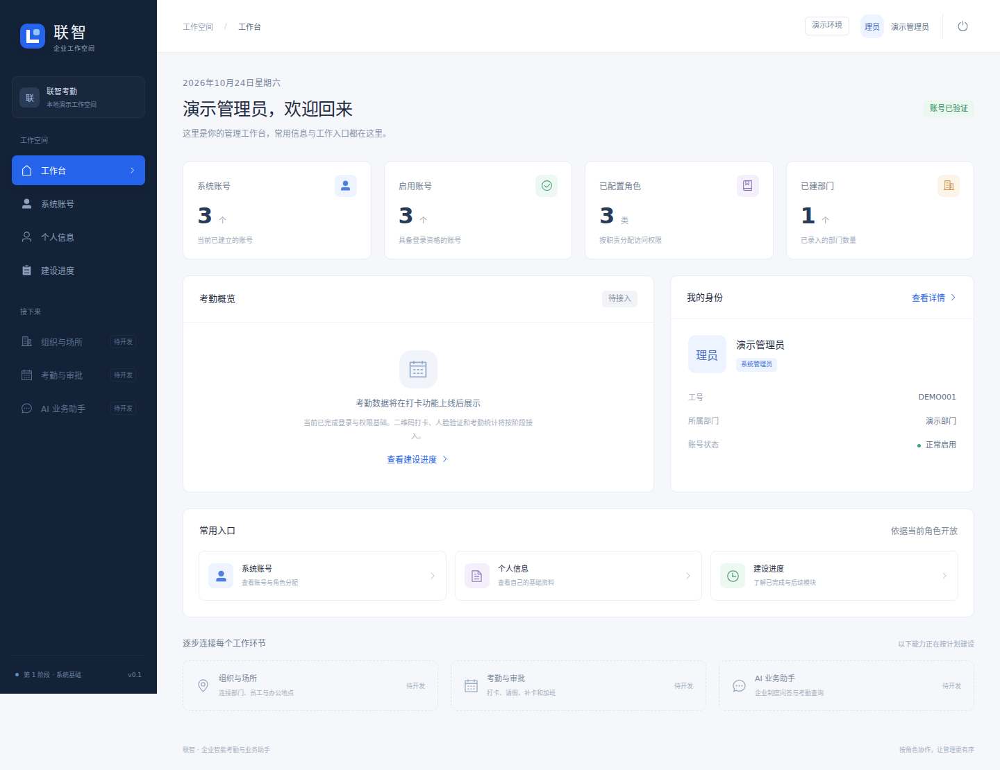

# 联智 · 企业智能考勤与业务助手

基于 Java 17、Spring Boot、MyBatis、Vue 3、Element Plus、Pinia 和 MySQL 的工程实践项目。当前包含 **A1基础档案、B正式排班与扫码考勤、A2.2真实申请审批及C本人业务查询**。

## 三人协作与 Codex 交接

三人分工、公共约定、每人任务与GitHub同步要求已整理在 [协作入口](docs/team/README.md)。在各自项目目录打开Codex，按对应任务继续已有代码。每完成一小阶段，验证后提交并推送个人分支，通过PR整合。

2026-10-27已核对B/C远端步骤、公共文件冲突和接口差异，详见[整合记录](docs/team/integration-2026-10-27.md)。

## 当前可以体验

- 管理员、人事专员、员工三种角色的登录、退出及页面刷新后的会话恢复。
- 后端接口权限校验、前端路由权限和按角色展示菜单。
- 管理工作台：读取数据库中的账号、角色和部门数量。
- 管理员在“系统账号”页分配登录账号，选择员工、人事或管理员角色；通过“管理账号”重设密码、调整角色和停用账号。账号与员工档案关联。
- 员工工作台、个人信息、项目建设进度。
- 所有角色可在“个人信息”预览、上传及移除本人头像，顶栏与账号列表同步显示；默认使用名称头像。账号初始/重设密码最低4位。
- A2.2本人请假/补卡/加班申请真实保存，支持撤回、人事审批与历史；审核和B考勤调整同事务，不改写原始打卡。
- 考勤工作台支持真实排班、二维码与定位打卡、本人日记录；业务助手可查询本人考勤、申请进度和审批来源，并进入完整申请审计。
- 管理员/人事可查询[统计报表](docs/modules/c-reports.md)，按公司、部门、员工、场所和日期筛选，查看工时趋势、场所出勤热度及可回查日记录，导出同权限CSV。业务助手支持用户明确确认后的申请提交。
- 组织与场所管理：公司、部门、员工分页查询与维护、角色/停用、办公坐标与场所绑定；HR限定公司范围，员工查看本人公司与场所。接口见[A模块](docs/modules/a-api.md)。
- 中文界面，适配电脑和手机窄屏。
- BCrypt 密码存储、HttpOnly 会话 Cookie、CSRF 校验；数据库通过 Flyway 自动迁移。

**尚未开放：**真实人脸识别、知识库上传/检索、模型问答及已生效审批的反向撤销。B的V5存储已正式发布，真实SDK处理仍默认关闭。C已提供解析、检索和模型协议基础组件，V6未启用。A记录了本机MySQL与真实地图选点验证，实际设备定位仍待验证；未配置的外部服务明确提示，不生成虚假的业务结果。

C提供[Docker、同源代理与环境配置](deploy/README.md)，本机尚无Docker，容器启动及C报表MySQL联验待执行。场所图是按坐标系分组的相对分布与热度，不等同地图连续热力或预测。

## 当前界面



登录页与员工手机页面：[登录页](docs/screenshots/login.png) · [员工手机页面](docs/screenshots/employee-mobile.png)

## Windows 快速启动

只用于课堂展示时，可使用[前后端合一展示包](tools/classroom/README.md)：运行时只需Java17或以上，不需要Node/MySQL/人脸SDK；合成员工与演示定位有明确标注，二维码、打卡、申请审批和480分钟请假回写调用真实服务。

前置安装：**JDK 17、Node.js 22 LTS、Git**。首次运行需要联网下载依赖，Maven 由项目内的 Wrapper 自动准备。

```powershell
git clone https://github.com/dramagon/lianzhi-attendance.git
cd lianzhi-attendance
```

打开两个 PowerShell 窗口，在项目根目录分别运行：

```powershell
# 窗口一：启动后端（8080）
powershell -ExecutionPolicy Bypass -File .\scripts\start-backend.ps1
```

```powershell
# 窗口二：安装前端依赖并启动（5173）
powershell -ExecutionPolicy Bypass -File .\scripts\start-frontend.ps1
```

浏览器访问 **http://127.0.0.1:5173**。两个窗口保持运行，停止时按 `Ctrl+C`。

默认使用本地 H2 文件数据库，无需先安装 MySQL。数据保存在 `backend/data/`，重启保留，不会上传 GitHub。演示模式仅供本机学习，默认监听本机地址。

| 演示身份 | 账号 | 密码 |
| --- | --- | --- |
| 系统管理员 | `admin` | `Lianzhi@2026` |
| 人事专员 | `hr` | `Lianzhi@2026` |
| 员工 | `employee` | `Lianzhi@2026` |

登录页可以点击身份按钮填入演示账号。以上均为公开的测试身份，非真实员工。非演示环境不会自动创建这些账号。

## macOS / Linux

```bash
# 窗口一
cd backend
./mvnw spring-boot:run
```

```bash
# 窗口二
cd frontend
npm ci
npm run dev
```

## 切换 MySQL

参见 [Windows 环境与 MySQL 启动说明](docs/windows-setup.md)。MySQL 模式与演示数据库完全独立；首次启动需要通过环境变量设置管理员密码，不提供生产默认密码。

本机凭据配置完成后，使用 `scripts/setup-mysql.ps1` 初始化专用库/账号，`scripts/start-mysql-backend.ps1 -JavaHome 'C:\Program Files\Java\jdk-17'` 启动MySQL模式。随机密码仅保存于忽略目录 `artifacts/mysql-app.local.ps1`，管理员初始账号为 `admin`。`scripts/test-mysql.ps1` 使用独立的 `lianzhi_verify` 库进行后端测试，不对正式库运行测试夹具。

## 验证

```powershell
cd backend
.\mvnw.cmd test
```

前端浏览器测试需要先启动演示后端，之后运行：

```powershell
cd frontend
npm ci
npx playwright install chromium
npm run test:e2e
npm run build
```

前端通过 Vite 将 `/api` 代理到后端，浏览器只访问同一来源，不需要关闭浏览器安全限制。生产部署须将静态文件与 `/api` 配为同源代理，并启用 HTTPS；当前没有提供公网生产部署成品。

## 项目结构

```text
backend/                 Spring Boot、认证、权限、MyBatis、数据库迁移与测试
frontend/                Vue 页面、路由、状态、样式与浏览器测试
scripts/                 Windows 启动脚本
docs/                    环境说明、接口约定、模块规划与验证记录
```

详细说明：[模块规划](docs/roadmap.md) · [接口与权限](docs/api.md) · [验证记录](docs/verification.md)

## B：正式排班与考勤

本分支已整合A组织前置能力。管理员先维护公司/员工及WGS84办公场所绑定，再进入「考勤工作台→正式排班与日考勤」保存班次；管理人员生成短时二维码，员工扫码或识别本机二维码图片、获取定位后完成上下班。原始记录和日结果从数据库读取，审批调整独立保留来源。

首次启动会依次应用V1→V2→V3→V4→V4.1→V5，请备份已有业务库，不要手动执行候选SQL或启用out-of-order。旧账号无公司归属时须由管理员设置；不自动补造场所或考勤。人脸SDK未接入，登记/验证保持关闭。接口和实际限制见[考勤说明](docs/modules/b-api.md)，跨成员事项见[B交接](docs/team/member-b-handoff-2026-10-27.md)。

B模块独立MySQL验证（需Docker、Python3与JDK，无需宿主机安装MySQL）：`python scripts/test-attendance-mysql.py`。脚本使用独立容器和随机测试凭据，验证迁移、并发、审批回滚及数据库重启保留，只清理本次测试容器。详见[真实MySQL验证记录](docs/verification/member-b-mysql-2026-10-27.md)。

手机验收准备：登录后进入「考勤工作台→手机设备检查」。独立HTTPS工具及证书/局域网说明见[手机验收工具](tools/mobile-acceptance/README.md)，真机结果填写[验收表](docs/team/member-b-mobile-checklist.md)。云端自检不等于真机已通过。

打卡提交后断网或超时时，页面保留待确认请求编号并暂停新提交；联网或刷新后只查询本人回执，确认成功后解除等待，不自动重发。暂未查到时可稍后再核对，或确认后重新扫码和定位。人脸预览可取消授权等待，切后台释放摄像头；真实SDK仍按[接入交接](docs/modules/b-face-integration.md)推进。

人脸业务流程代码已补齐：本人登记/更新/删除、加密特征、短时挑战、服务端判定及与打卡同事务消费。手机采集界面需明确授权，V5存储已按正式V4/V4.1顺序发布；缺实际SDK适配器、官方授权、加密密钥或阈值时处理仍关闭。用户目标为Windows，目前尚无SDK与授权，因此不宣称真实识别已完成；配置入口见接入交接。设备检查页支持下载人工验收报告，默认全部未执行，不保存坐标、二维码或图像。

2026-11-03已接入A正式审批182d248并发布V5存储。`python scripts/test-attendance-mysql.py --face-workflow`可在一次性容器验证审批/考勤与人脸业务（明确使用测试SDK替身，不代表识别通过）；迁移和联调更新见[B交接](docs/team/member-b-handoff-2026-10-27.md)。

## C模块本机整合交付

C收尾实现与真实验证见[收尾契约](docs/modules/c-completion.md)和[验收记录](docs/verification/member-c-completion.md)。当前电脑可双击根目录 `start-c-full.cmd` 启动本地真实模型、embedding、OCR、转写和同源应用；独立依赖保存在Git忽略目录，不含在仓库。其他电脑按[安装说明](docs/modules/c-media-services.md)配置。完整课程的共享中间件、真实地图/SDK、手机、云效与集群验收仍需整组落实。


### 无SDK课堂整站展示

B分支提供离线整站展示包：Java17+启动，无需Node/MySQL/SDK或外部模型。进入课堂演示台后点击“一键整站演示”，实际运行打卡→审批回写→报表/CSV→DOCX上传解析/文字检索→带出处原文摘录。人脸保持设备预览，制度回答标注非生成式AI；真实SDK、向量、OCR、转写和模型服务另按对应部署说明配置。运行和构建方法见[课堂展示说明](tools/classroom/README.md)。
